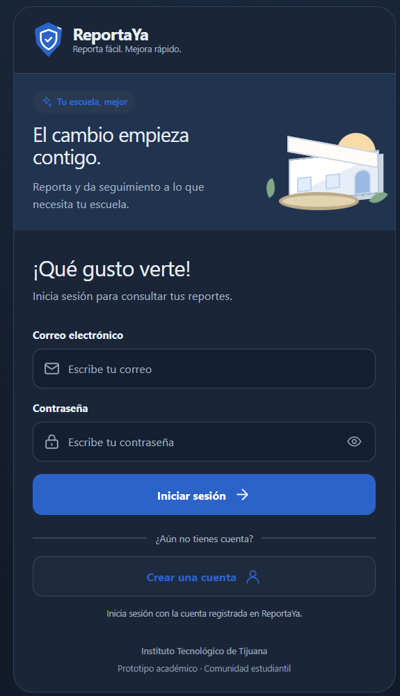
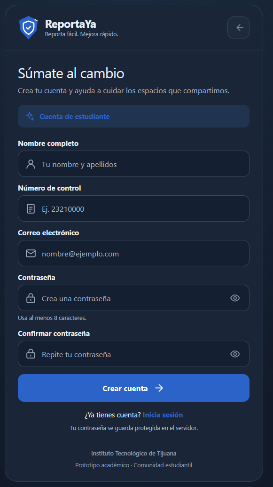
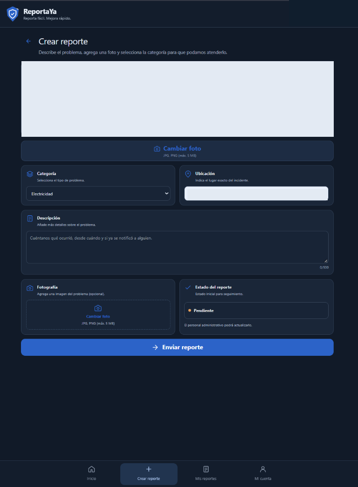
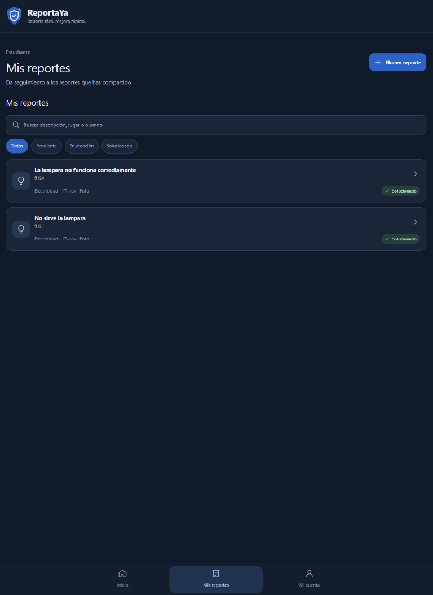
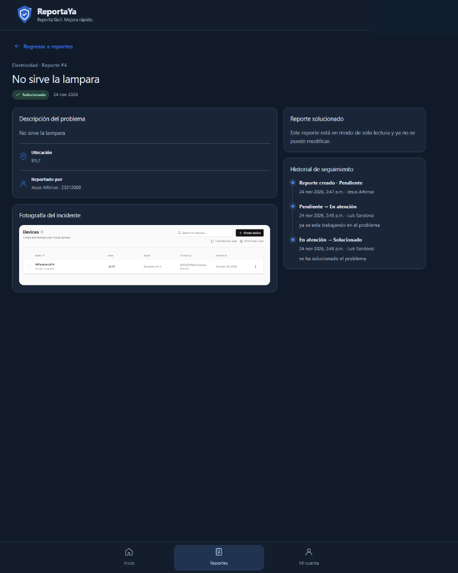
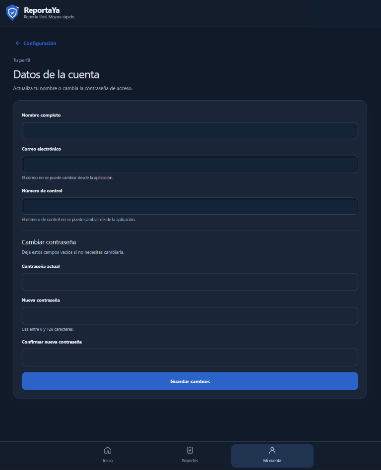
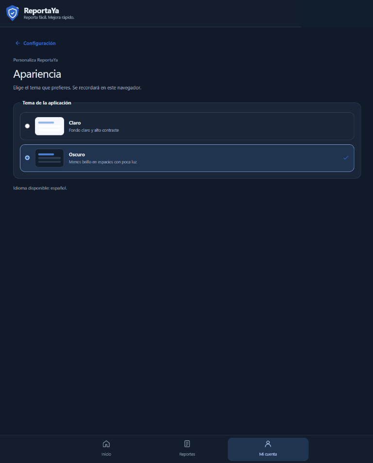
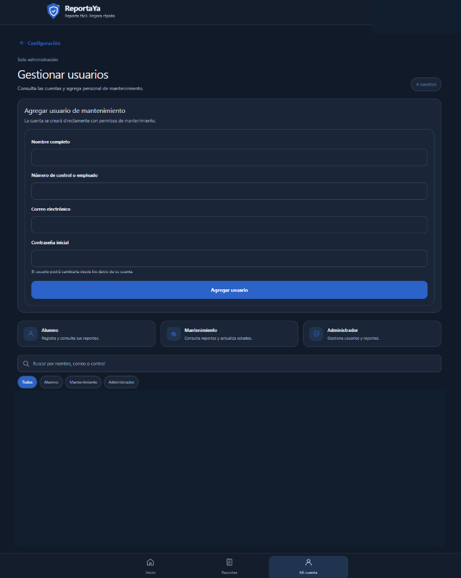
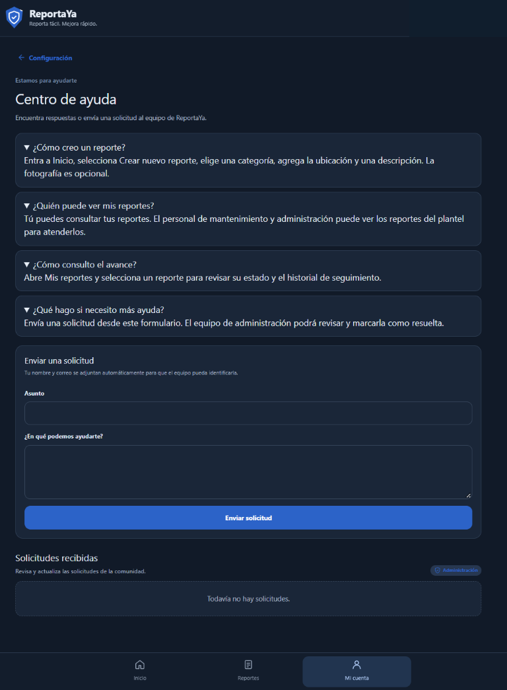

# Manual de Usuario — ReportaYa

**Proyecto:** ReportaYa | **Curso:** Gestión de Proyectos de Software
**Equipo desarrollador:** [Agregar los nombres oficiales del equipo]

> Las capturas son de la aplicación y se prepararon copias con datos identificables ocultos antes de publicarlas.

## Índice

1. [Introducción](#1-introducción)
2. [Objetivo del sistema](#2-objetivo-del-sistema)
3. [Descripción general](#3-descripción-general)
4. [Requisitos](#4-requisitos)
5. [Instalación y acceso](#5-instalación-y-acceso)
6. [Registro e inicio de sesión](#6-registro-e-inicio-de-sesión)
7. [Módulos y guía paso a paso](#7-módulos-y-guía-paso-a-paso)
8. [Ejemplo de uso](#8-ejemplo-de-uso)
9. [Problemas frecuentes](#9-problemas-frecuentes)
10. [Conclusiones](#10-conclusiones)
11. [Datos del equipo](#11-datos-del-equipo)

## 1. Introducción

ReportaYa permite comunicar problemas de infraestructura escolar y consultar qué atención reciben. El manual describe el uso de la aplicación desde una cuenta de estudiante, mantenimiento y administración.

## 2. Objetivo del sistema

Facilitar el registro, la consulta y el seguimiento de problemas escolares en un mismo sistema, manteniendo el acceso a la información según el rol de cada cuenta.

## 3. Descripción general

Los reportes tienen una categoría, ubicación, descripción, fecha y estado: **Pendiente**, **En atención** o **Solucionado**. Se puede adjuntar una imagen JPG o PNG de hasta 5 MB. El historial conserva los cambios de estado y las notas del personal.

- Un estudiante crea reportes y consulta únicamente los propios.
- Mantenimiento consulta la bandeja del plantel y actualiza el seguimiento.
- Administración supervisa reportes y crea cuentas de mantenimiento.
- El registro público crea cuentas de estudiante. La aplicación no convierte una cuenta existente de estudiante a mantenimiento ni al revés.
- Cuando un reporte está solucionado, el estudiante y mantenimiento lo consultan en modo de solo lectura.

## 4. Requisitos

- Una computadora con navegador web actualizado.
- Para ejecutar la aplicación localmente: Node.js, npm y MySQL Server.
- Conexión MySQL configurada en `backend/.env`; nunca compartas ese archivo.
- Para acceder a funciones administrativas se necesita una cuenta inicial configurada por el equipo.

## 5. Instalación y acceso

Sigue los pasos del [README principal](../README.md#instalación-y-ejecución): prepara MySQL, configura `backend/.env` e inicia los servidores del backend y frontend. Después, abre `http://localhost:5173`.

En Windows PowerShell, si `npm` está bloqueado por la política de ejecución, usa `npm.cmd`.

## 6. Registro e inicio de sesión

### Crear una cuenta de estudiante

1. En la pantalla inicial, selecciona **Crear una cuenta**.
2. Escribe nombre completo, número de control, correo y contraseña.
3. Confirma la contraseña y selecciona **Crear cuenta**.
4. La cuenta creada tiene rol de estudiante.

### Iniciar sesión

1. Escribe el correo y la contraseña registrados.
2. Selecciona **Iniciar sesión**.
3. Usa **Mostrar contraseña** si necesitas comprobar lo que escribiste.
4. Para salir, abre **Mi cuenta → Cerrar sesión**.

## 7. Módulos y guía paso a paso

### Inicio y navegación

La pantalla de inicio muestra un saludo, un resumen por estado y los reportes disponibles para el rol. La barra inferior permite abrir **Inicio**, **Reportes** y **Mi cuenta**. El estudiante también cuenta con **Crear reporte**.

### Crear un reporte (estudiante)

1. En Inicio, selecciona **Crear nuevo reporte**.
2. Elige la categoría del problema.
3. Indica el edificio y lugar específico.
4. Describe qué ocurre y añade los detalles necesarios.
5. Si lo necesitas, adjunta una imagen JPG o PNG de hasta 5 MB.
6. Revisa la información y selecciona **Enviar reporte**.
7. El reporte aparece como **Pendiente** en **Mis reportes**.

### Consultar y filtrar reportes

1. Abre **Reportes** o **Mis reportes**.
2. Busca por descripción, ubicación o alumno cuando la bandeja del rol lo permita.
3. Usa los botones de estado para filtrar los resultados.
4. Selecciona un reporte para abrir el detalle, revisar su estado y consultar el historial.

Los estudiantes ven sus reportes. Mantenimiento y administración consultan la bandeja general.

### Actualizar el seguimiento (mantenimiento)

1. Abre un reporte desde la bandeja.
2. En **Actualizar estado**, elige el estado siguiente.
3. Si corresponde, escribe una nota breve del avance.
4. Selecciona **Guardar estado**.
5. Comprueba que el cambio aparezca en el historial.

El personal de mantenimiento no puede editar un reporte después de marcarlo como solucionado.

### Reportes solucionados

Al abrir un reporte solucionado, estudiantes y mantenimiento ven una indicación de solo lectura. Ya no se puede actualizar su estado desde esos roles.

### Notificaciones

Selecciona el botón de campana en la cabecera para abrir la vista emergente. El contador indica las notificaciones pendientes de leer. Desde allí puedes abrir el reporte, marcar una notificación como leída o consultar todas las notificaciones.

### Mi cuenta y datos del perfil

1. Abre **Mi cuenta → Datos de la cuenta**.
2. Actualiza el nombre si es necesario.
3. Para cambiar la contraseña, ingresa la contraseña actual, la nueva y su confirmación.
4. Guarda los cambios.

El correo y el número de control no se pueden editar desde la aplicación.

### Apariencia

En **Mi cuenta → Apariencia**, selecciona **Claro** u **Oscuro**. La preferencia queda guardada en el navegador.

### Administración de usuarios

1. Inicia sesión con una cuenta administradora.
2. Abre **Mi cuenta → Gestionar usuarios**.
3. En **Agregar usuario de mantenimiento**, completa nombre, número de control o empleado, correo y contraseña inicial.
4. Selecciona **Agregar usuario**.
5. Usa la búsqueda y los filtros para consultar las cuentas existentes.

La pantalla no permite cambiar el rol de un usuario existente.

### Centro de ayuda y privacidad

En **Mi cuenta → Centro de ayuda**, consulta las preguntas frecuentes o envía una solicitud con asunto y descripción. Administración puede revisar y resolver las solicitudes. En **Privacidad** se explican las reglas de acceso a reportes y datos.

## 8. Ejemplo de uso

1. Un estudiante registra que una lámpara no funciona, indica edificio y salón, describe el problema y envía el reporte.
2. El reporte queda en estado **Pendiente** y el estudiante puede consultarlo en **Mis reportes**.
3. Mantenimiento abre el reporte, cambia su estado a **En atención** y añade una nota.
4. Al terminar el trabajo, mantenimiento marca el reporte como **Solucionado**.
5. El estudiante recibe una notificación. El detalle conserva el historial y queda en modo de solo lectura.

## 9. Problemas frecuentes

| Problema | Qué revisar |
| --- | --- |
| No carga la aplicación | Confirma que frontend y backend estén iniciados en sus terminales. |
| No conecta con el servidor | Verifica que MySQL esté activo, revisa `backend/.env` y confirma que el backend escuche en el puerto 3001. |
| La cuenta no inicia sesión | Comprueba el correo y contraseña; el registro público debe haberse completado. |
| No puedo abrir todos los reportes | El acceso depende del rol: estudiantes solo consultan sus propios reportes. |
| No puedo editar un reporte solucionado | Es el comportamiento esperado para estudiantes y mantenimiento. |
| No se adjunta una fotografía | Usa JPG/PNG y comprueba que mida 5 MB o menos. |
| PowerShell bloquea `npm` | Ejecuta el comando con `npm.cmd`. |

## 10. Conclusiones

ReportaYa organiza el registro y seguimiento de problemas escolares con vistas según el rol, historial de cambios y notificaciones. El sistema requiere una instancia MySQL configurada; las pruebas automatizadas y los pasos de instalación se encuentran en el repositorio.

## 11. Datos del equipo

- **Integrantes:** [Agregar nombres completos de las personas integrantes]
- **Proyecto:** ReportaYa
- **Curso:** Gestión de Proyectos de Software
- **Repositorio:** [NolascoAyalaGael-07/reportaYa](https://github.com/NolascoAyalaGael-07/reportaYa)
